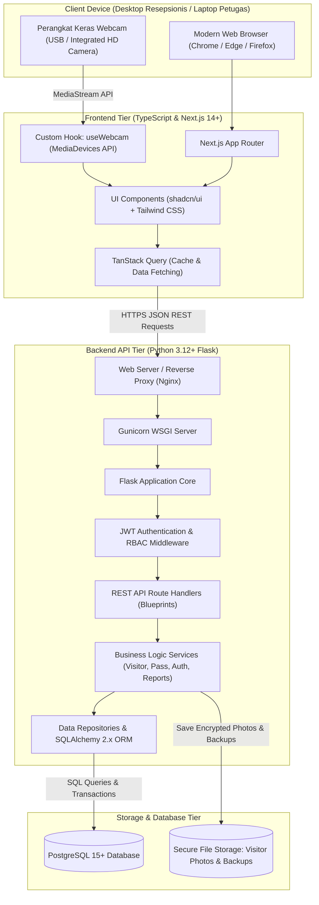

# PERANCANGAN ARSITEKTUR SISTEM
# SISTEM INFORMASI BUKU TAMU DIGITAL

**Versi:** 1.0 (Sprint 1 — Analisis dan Perancangan)  
**Metodologi:** Client-Server Multi-tier dengan RESTful API Architecture  

---

## 1. Arsitektur Komponen Tingkat Tinggi

Sistem Informasi Buku Tamu Digital dibangun menggunakan arsitektur modern yang memisahkan secara bersih antara lapisan penyajian antarmuka (*Presentation Layer / Frontend*), logika bisnis (*Application Service Layer / Backend*), dan lapisan penyimpanan (*Persistence Layer / Database & Object Storage*).



---

## 2. Struktur Modul Backend & Frontend

Sesuai standar yang ditetapkan pada PRD bab 9.3:

```
buku-tamu/
├── backend/
│   ├── app/
│   │   ├── models/            # Deklarasi model ORM SQLAlchemy (User, Pass, Visitor, Setting, dll.)
│   │   ├── schemas/           # Validasi skema request/response (Pydantic / Marshmallow)
│   │   ├── routes/            # Blueprint REST API (auth, dashboard, visitors, pass, settings)
│   │   ├── services/          # Logika bisnis inti (CheckinService, PassService, AuthService)
│   │   ├── repositories/      # Abstraksi query database per entitas
│   │   ├── middleware/        # Validasi JWT token, otorisasi RBAC, rate limiting, error handlers
│   │   └── utils/             # Helper kamera, upload file, hashing Argon2/Bcrypt, logger
│   ├── migrations/            # Script migrasi skema database Alembic
│   ├── tests/                 # Unit test & integration test (pytest)
│   ├── config.py              # Konfigurasi aplikasi berbasis Environment Variables
│   ├── requirements.txt       # Dependensi pustaka Python
│   └── run.py                 # Titik masuk eksekusi aplikasi backend Flask
│
├── frontend/
│   ├── src/
│   │   ├── app/               # Next.js App Router (login, dashboard, checkin, checkout, pass, settings)
│   │   ├── components/        # Komponen UI modular (Navbar, Sidebar, Camera, PassRack, Tables, Modals)
│   │   ├── hooks/             # Custom React Hooks (useWebcam, usePassAvailability, useAuth)
│   │   ├── services/          # HTTP API client (Axios / Fetch wrapper dengan auth interceptor)
│   │   ├── types/             # Definisi tipe data TypeScript (User, Visitor, Pass, Setting)
│   │   └── lib/               # Utility helper (format tanggal, class merge cn, konstanta)
│   ├── package.json           # Dependensi pustaka TypeScript & React
│   └── tailwind.config.ts     # Konfigurasi token warna tema maroon & ivory
│
├── docs/                      # Dokumentasi Sprint, UI/UX, ERD, dan Backlog
│   ├── ui-ux-design.md
│   ├── erd.md
│   ├── architecture.md
│   └── product-backlog.md
├── database.md                # Skema DDL SQL murni PostgreSQL
├── prd.md                     # Dokumen PRD Buku Tamu Digital
└── README.md                  # Panduan instalasi dan deployment
```

---

## 3. Desain Kontrak RESTful API Utama

Semua response REST API menggunakan format JSON terstandarisasi:

```json
{
  "success": true,
  "message": "Deskripsi respon",
  "data": {},
  "meta": {
    "page": 1,
    "limit": 10,
    "total": 48
  }
}
```

### 3.1 Modul Autentikasi (`/api/v1/auth`)
- `POST /api/v1/auth/login` : Autentikasi kredensial pengguna, mengembalikan Access Token (JWT) & Refresh Token (HTTP-Only Cookie).
- `POST /api/v1/auth/refresh` : Memperbarui access token yang telah kadaluwarsa.
- `POST /api/v1/auth/logout` : Revokasi token refresh dan menghapus sesi.
- `GET /api/v1/auth/me` : Mengambil informasi profil dan permission pengguna yang sedang login.

### 3.2 Modul Pengunjung & Check-In (`/api/v1/visitors`)
- `GET /api/v1/visitors` : Mendapatkan daftar riwayat kunjungan (didukung filter rentang tanggal, status, pencarian, paginasi).
- `GET /api/v1/visitors/active` : Mendapatkan daftar pengunjung yang sedang berada di lokasi (`check_out_at IS NULL`).
- `POST /api/v1/visitors/checkin` : Mendaftarkan tamu baru, mengunggah foto wajah wajib, dan mengalokasikan nomor pass berstatus `AVAILABLE` dalam satu transaksi database atomik (*ACID transaction*).
- `POST /api/v1/visitors/{id}/checkout` : Memproses kepulangan tamu, memvalidasi pass fisik dikembalikan, mencatat waktu keluar otomatis, dan mengembalikan status pass menjadi `AVAILABLE`.
- `GET /api/v1/visitors/{id}` : Mendapatkan detail profil dan riwayat kunjungan tamu.

### 3.3 Modul Manajemen Pass (`/api/v1/pass`)
- `GET /api/v1/pass` : Mendapatkan status seluruh pass dan pemetaan slot rak.
- `GET /api/v1/pass/available` : Mendapatkan nomor-nomor pass yang siap digunakan.
- `POST /api/v1/pass` : Menambahkan nomor pass baru ke sistem (Admin).
- `PUT /api/v1/pass/{id}/status` : Memperbarui kondisi fisik pass (`AVAILABLE`, `MAINTENANCE`, `LOST`).

### 3.4 Modul Dashboard & Statistik (`/api/v1/dashboard`)
- `GET /api/v1/dashboard/metrics` : Total kunjungan hari ini, pengunjung aktif, pengunjung selesai, sisa pass tersedia.
- `GET /api/v1/dashboard/chart/daily` : Data distribusi jam sibuk kedatangan pengunjung.
- `GET /api/v1/dashboard/chart/status` : Distribusi status dan kapasitas penggunaan pass.

### 3.5 Modul Pengaturan & Backup (`/api/v1/settings` & `/api/v1/backup`)
- `GET /api/v1/settings` : Mengambil konfigurasi institusi, jam operasional, dan parameter sistem.
- `PUT /api/v1/settings` : Memperbarui konfigurasi sistem (Admin).
- `POST /api/v1/backup/manual` : Memicu proses backup database manual.
- `GET /api/v1/backup/histories` : Daftar riwayat backup data.
- `POST /api/v1/backup/restore` : Memproses pemulihan data dari file backup valid.

---

## 4. Mekanisme Keamanan & Integritas Transaksi

1. **Database ACID Concurrency Locking:**
   - Pada saat proses Check-In, pass yang dipilih dikunci menggunakan klausul `SELECT ... FOR UPDATE` dalam blok transaksi SQLAlchemy.
   - Hal ini mencegah terjadinya *race condition* jika dua petugas di meja berbeda memilih nomor pass yang sama secara simultan.
2. **Perlindungan File Foto Pengunjung:**
   - Foto pengunjung disimpan di direktori privat yang dilindungi otorisasi server (bukan folder public statis tanpa autentikasi).
   - URL foto dilayani melalui endpoint aman dengan verifikasi hak akses token (`GET /api/v1/visitors/{id}/photo`).
3. **Audit Logging Otomatis:**
   - Setiap mutasi data penting (check-in, check-out manual, perubahan status pass, login/logout) otomatis dicatat ke tabel `audit_logs` lengkap dengan IP address dan User Agent.

---

*Dokumen Arsitektur ini menjadi landasan teknis pelaksanaan Sprint 2 (Fondasi Backend dan Frontend).*
