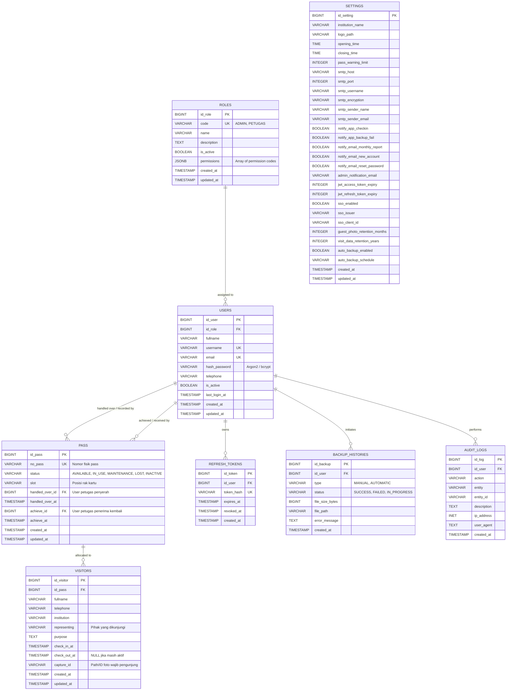

# FINALISASI ENTITY RELATIONSHIP DIAGRAM (ERD)
# SISTEM INFORMASI BUKU TAMU DIGITAL

**Versi:** 1.0 (Sprint 1 — Analisis dan Perancangan)  
**Database Management System:** PostgreSQL 15+  
**Referensi Skema:** [database.md](file:///c:/Buku-Tamu/database.md) & [prd.md](file:///c:/Buku-Tamu/prd.md)  

---

## 1. Diagram ERD Relasional

Berikut adalah diagram relasi antartabel dalam format Mermaid yang merefleksikan seluruh entitas dalam sistem buku tamu digital:



---

## 2. Rincian Relasi & Integritas Data

### 2.1 Relasi `roles` -> `users` (1 to Many)
- `users.id_role` mengacu pada `roles.id_role`.
- **Constraint:** `ON UPDATE CASCADE ON DELETE RESTRICT`. Role tidak boleh dihapus jika masih ada pengguna aktif yang menggunakannya.

### 2.2 Relasi `pass` -> `visitors` (1 to Many, dengan Partial Unique Constraint)
- Satu pass fisik dapat digunakan berulang kali oleh pengunjung yang berbeda sepanjang waktu.
- **Kondisi Khusus:** Pada saat bersamaan, satu pass hanya boleh aktif pada **1** pengunjung.
- **Implementasi Indeks Unik Parsial (PostgreSQL):**
  ```sql
  CREATE UNIQUE INDEX uq_visitors_active_pass
      ON visitors(id_pass)
      WHERE check_out_at IS NULL;
  ```
  Indeks parsial ini menjamin pada tingkat database bahwa tidak akan terjadi *double check-in* atau bentrok pass yang sama secara bersamaan (*concurrency-safe*).

### 2.3 Relasi `users` -> `pass` (1 to Many)
- `pass.handled_over_id` (petugas yang menyerahkan pass saat check-in).
- `pass.achieve_id` (petugas yang menerima pass kembali saat check-out).
- **Constraint:** `ON UPDATE CASCADE ON DELETE SET NULL`.

### 2.4 Relasi `users` -> `refresh_tokens` (1 to Many)
- Token refresh disimpan dalam bentuk hash kriptografi (`token_hash`), dengan pencatatan waktu kadaluwarsa (`expires_at`) dan waktu pembatalan/revokasi (`revoked_at`).
- **Constraint:** `ON UPDATE CASCADE ON DELETE CASCADE`.

### 2.5 Relasi `users` -> `audit_logs` & `backup_histories`
- Mencatat jejak audit seluruh aktivitas krusial pengguna (login, ubah pass, check-out paksa, backup/restore data).
- **Constraint:** `ON DELETE SET NULL` agar log audit tetap tersimpan sebagai bukti historis meskipun akun dihapus.

---

## 3. Strategi Indexing Kinerja Query

Untuk memastikan efisiensi pencarian pada saat transaksi ramai di meja resepsionis:

| Tabel | Indeks | Tujuan Penggunaan |
|---|---|---|
| `users` | `idx_users_role` | Filter pengguna berdasarkan role |
| `users` | `idx_users_active` | Filter pengguna aktif untuk autentikasi cepat |
| `pass` | `idx_pass_status` | Filter ketersediaan pass (`AVAILABLE`) saat check-in |
| `visitors`| `uq_visitors_active_pass` | Integritas pass aktif (hanya 1 kunjungan tanpa checkout) |
| `visitors`| `idx_visitors_fullname` | Autocomplete & pencarian nama pengunjung |
| `visitors`| `idx_visitors_telephone`| Pencarian cepat via nomor kontak WhatsApp/telepon |
| `visitors`| `idx_visitors_checkin` | Filter laporan dan statistik kunjungan harian/bulanan |
| `visitors`| `idx_visitors_checkout` | Filter tamu yang sedang aktif (`IS NULL`) |
| `refresh_tokens` | `idx_refresh_user`, `idx_refresh_expiry` | Validasi token refresh aktif dan pembersihan berkala |
| `audit_logs` | `idx_audit_user`, `idx_audit_created`, `idx_audit_entity` | Pencarian jejak audit sistem |

---

*Dokumen ERD ini telah diselaraskan penuh dengan `database.md` dan siap diimplementasikan menggunakan SQLAlchemy ORM serta migrasi Alembic pada Sprint 2.*
