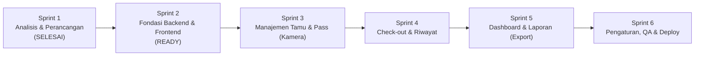

# PRODUCT BACKLOG & SPRINT PLANNING
# SISTEM INFORMASI BUKU TAMU DIGITAL

**Metode:** Agile Scrum (Sprint 2 Minggu per Siklus)  
**Status Progres:** Sprint 1 Selesai / Siap Menuju Sprint 2  

---

## 1. Ringkasan Roadmap Sprint

---

## 2. Rincian Product Backlog per Sprint

### Sprint 1: Analisis, Desain UI/UX & Perancangan Sistem (Durasi: 2 Minggu) — [SELESAI]

| Item ID | Task / User Story | Estimasi (Story Points) | Status | Output Dokumen / Kode |
|---|---|---|---|---|
| **PB-01** | Analisis kebutuhan pengguna & finalisasi PRD | 5 | Selesai | [prd.md](file:///c:/Buku-Tamu/prd.md) |
| **PB-02** | Perancangan UI/UX Design System berbasis kanvas Figma | 8 | Selesai | [docs/ui-ux-design.md](file:///c:/Buku-Tamu/docs/ui-ux-design.md) |
| **PB-03** | Finalisasi ERD, relasi entitas, constraint & indexing | 5 | Selesai | [docs/erd.md](file:///c:/Buku-Tamu/docs/erd.md) |
| **PB-04** | Perancangan arsitektur sistem & kontrak REST API | 5 | Selesai | [docs/architecture.md](file:///c:/Buku-Tamu/docs/architecture.md) |
| **PB-05** | Penyusunan Product Backlog terstruktur | 3 | Selesai | [docs/product-backlog.md](file:///c:/Buku-Tamu/docs/product-backlog.md) |
| **PB-06** | Inisialisasi struktur direktori proyek & Git repo | 3 | Selesai | Backend & Frontend scaffolding |

---

### Sprint 2: Fondasi Backend, Database & Frontend Auth (Durasi: 2 Minggu) — [NEXT SPRINT]

| Item ID | User Story / Task | Role | Prioritas | SP |
|---|---|---|---|---|
| **PB-07** | Inisialisasi proyek Flask, virtualenv, dan konfigurasi lingkungan | Backend | Must Have | 5 |
| **PB-08** | Implementasi model SQLAlchemy 2.x & inisialisasi Alembic migration | Backend | Must Have | 8 |
| **PB-09** | Implementasi endpoint autentikasi login, refresh token, & logout | Backend | Must Have | 8 |
| **PB-10** | Implementasi middleware JWT & otorisasi RBAC (Admin vs Petugas) | Backend | Must Have | 5 |
| **PB-11** | Inisialisasi Next.js (App Router), TypeScript & Tailwind CSS | Frontend | Must Have | 5 |
| **PB-12** | Konfigurasi tema warna Figma (`#92001E`, `#FEF7EC`, typography) | Frontend | Must Have | 3 |
| **PB-13** | Implementasi Halaman Login sesuai Figma (Background blur & Form) | Frontend | Must Have | 5 |
| **PB-14** | Implementasi Base Layout (Sidebar Navigasi Maroon & Topbar Header) | Frontend | Must Have | 8 |

---

### Sprint 3: Manajemen Pengunjung, Kamera Web & Check-In (Durasi: 2 Minggu)

| Item ID | User Story / Task | Role | Prioritas | SP |
|---|---|---|---|---|
| **PB-15** | API CRUD Data Pengunjung & validasi data input | Backend | Must Have | 8 |
| **PB-16** | API Manajemen Pass (nomor pass, ketersediaan, status) | Backend | Must Have | 5 |
| **PB-17** | Implementasi service upload & penyimpanan foto terenkripsi | Backend | Must Have | 5 |
| **PB-18** | Transaksi database atomik check-in dengan locking pass | Backend | Must Have | 8 |
| **PB-19** | Halaman Formulir Registrasi Pengunjung dengan validasi Zod | Frontend | Must Have | 5 |
| **PB-20** | Komponen integrasi Kamera Browser (`useWebcam`) & Shutter Capture | Frontend | Must Have | 8 |
| **PB-21** | Komponen pemilihan nomor pass tersedia (`<PassRackGrid />`) | Frontend | Must Have | 5 |
| **PB-22** | Modal Popup Sukses Penyerahan Pass ("Nomor pass anda: XX") | Frontend | Must Have | 3 |

---

### Sprint 4: Check-Out Pengunjung & Riwayat (Durasi: 2 Minggu)

| Item ID | User Story / Task | Role | Prioritas | SP |
|---|---|---|---|---|
| **PB-23** | API pencarian kunjungan aktif & validasi kepulangan tamu | Backend | Must Have | 5 |
| **PB-24** | API Check-Out (update `check_out_at`, kembalikan pass ke `AVAILABLE`) | Backend | Must Have | 8 |
| **PB-25** | API riwayat kunjungan dengan filter multi-parameter & paginasi | Backend | Must Have | 5 |
| **PB-26** | Halaman Check-Out & daftar tabel pengunjung yang masih berada di lokasi | Frontend | Must Have | 8 |
| **PB-27** | Modal Konfirmasi Pengembalian Pass Fisik | Frontend | Must Have | 5 |
| **PB-28** | Halaman Visualisasi Rak Pass (Monitoring ketersediaan real-time) | Frontend | Must Have | 5 |

---

### Sprint 5: Dashboard Statistik & Laporan Kunjungan (Durasi: 2 Minggu)

| Item ID | User Story / Task | Role | Prioritas | SP |
|---|---|---|---|---|
| **PB-29** | API agregasi metrik dashboard (kunjungan harian, pass aktif/sisa) | Backend | Must Have | 5 |
| **PB-30** | API data grafik kunjungan per jam kerja & tren mingguan | Backend | Must Have | 5 |
| **PB-31** | Fitur generator ekspor laporan ke format PDF dan Excel (.xlsx) | Backend | Should Have| 8 |
| **PB-32** | Tampilan Dashboard Utama dengan 4 kartu metrik gelap kontras | Frontend | Must Have | 8 |
| **PB-33** | Komponen Bar Chart & Donut Chart interaktif | Frontend | Must Have | 5 |
| **PB-34** | Halaman Laporan Kunjungan dengan tombol Filter & Ekspor | Frontend | Should Have| 5 |

---

### Sprint 6: Pengaturan Sistem, Pengujian Komprehensif & Deployment (Durasi: 2 Minggu)

| Item ID | User Story / Task | Role | Prioritas | SP |
|---|---|---|---|---|
| **PB-35** | API Pengaturan Institusi, Jam Operasional & Notifikasi SMTP | Backend | Should Have| 5 |
| **PB-36** | Modul Backup & Restore Database PostgreSQL | Backend | Should Have| 8 |
| **PB-37** | Halaman Tab Pengaturan Sistem (Umum, Notifikasi, Sesi, Retensi, Backup) | Frontend | Should Have| 8 |
| **PB-38** | Unit testing & Integration testing (pytest backend & react-testing-library) | QA | Must Have | 8 |
| **PB-39** | User Acceptance Testing (UAT) skenario operasional resepsionis | QA | Must Have | 5 |
| **PB-40** | Konfigurasi production environment, HTTPS, Nginx & Deployment | DevOps | Must Have | 8 |
