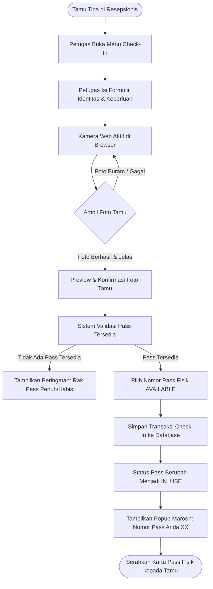
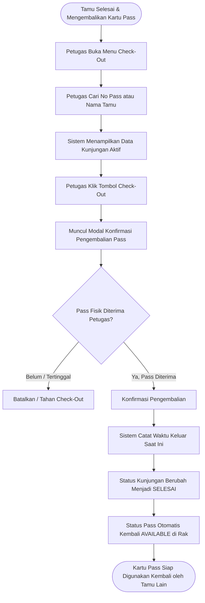

# DOKUMENTASI DESAIN UI/UX
# SISTEM INFORMASI BUKU TAMU DIGITAL

**Figma Reference:** [Figma Design Canvas - Buku Tamu Digital](https://www.figma.com/design/gr5mXhJ5PwRqbeRlHc4U5o/Untitled?node-id=0-1&p=f&t=bcRTG9iSiitqg2Ty-0)  
**Versi:** 1.0 (Sprint 1 — Analisis dan Perancangan)  
**Status:** Approved for Implementation  
**Frontend Framework Target:** Next.js (TypeScript) + Tailwind CSS + shadcn/ui  

---

## 1. Ringkasan Desain & Filosofi Visual

Desain Sistem Informasi Buku Tamu Digital dirancang berdasarkan acuan kanvas Figma dengan pendekatan antarmuka yang bersih, elegan, profesional, dan berorientasi pada kecepatan operasional resepsionis/petugas keamanan. 

### Karakteristik Visual Utama:
- **Tema Warna Formal & Berwibawa:** Memadukan warna merah marun (*Crimson/Burgundy Maroon*) sebagai identitas utama institusi dengan latar belakang *warm ivory/cream* yang nyaman di mata untuk pemakaian durasi lama di meja resepsionis.
- **Hierarki Informasi yang Tegas:** Menampilkan indikator angka kunci (KPI) dalam kartu gelap kontras tinggi (*dark card widgets*) di bagian atas dashboard, memudahkan petugas melihat status secara sekilas (*at-a-glance monitoring*).
- **Keamanan & Verifikasi Nyata:** Fitur kamera webcam terintegrasi langsung pada antarmuka check-in dengan validasi wajib foto pengunjung sebelum pass diterbitkan.
- **Manajemen Fisik Pass Visual:** Representasi grid visual rak pass (*pass slot rack*) yang memperlihatkan pass tersedia, digunakan, maupun dalam perawatan secara real-time.

---

## 2. Design System & Design Tokens

### 2.1 Palet Warna (Color Palette)

| Kategori Token | Nama Token | Nilai Hex | Penggunaan Utama |
|---|---|---|---|
| **Primary Brand** | `maroon-800` | `#92001E` | Tombol utama, header topbar, aksen menu aktif, border penting |
| **Primary Dark** | `maroon-950` | `#650015` | Background sidebar navigasi, header modal, hover state primary |
| **Primary Light** | `maroon-50` | `#FDF2F4` | Background badge pasif, alert subtle, highlight row |
| **Background App** | `ivory-50` | `#FEF7EC` | Background utama seluruh halaman operasional |
| **Background Alt** | `ivory-100` | `#FFF6EC` | Kontainer sekunder, panel sub-navigasi pengaturan |
| **Surface Card** | `white` | `#FFFFFF` | Kontainer form, card data tabel, modal dialog popup |
| **Surface Dark** | `card-dark` | `#1A1918` | Kartu metrik KPI (Total Kunjungan, Pass Digunakan, Pass Tersedia) |
| **Border Neutral** | `border-subtle` | `#EAD8C7` | Garis pembatas tabel, input border, garis pemisah modul |
| **Text Primary** | `text-main` | `#2B2523` | Judul, label formulir, teks isi utama |
| **Text Muted** | `text-secondary`| `#736F6C` | Keterangan, timestamp, placeholder, label kecil |
| **Success/Available**| `status-green` | `#16A34A` | Badge status pass "AVAILABLE", toggle aktif, indikator sukses |
| **Warning/In-Use** | `status-orange`| `#EA580C` | Badge status "IN_USE", peringatan batas pass, status pending |
| **Danger/Alert** | `status-red` | `#DC2626` | Tombol batalkan, pass "LOST", error validasi form |

### 2.2 Tipografi (Typography)

Sistem menggunakan font sans-serif modern yang mudah dibaca (*Inter* atau *Plus Jakarta Sans*):

- **Display / H1:** 24px - 28px | SemiBold (600) / Bold (700) | Judul Halaman & Angka Metrik Utama
- **Heading / H2:** 18px - 20px | SemiBold (600) | Judul Kartu, Judul Modal, Sub-bagian
- **Subheading / H3:** 15px - 16px | Medium (500) | Header Tabel, Tab Navigasi, Subtitle
- **Body / Regular:** 13px - 14px | Regular (400) / Medium (500) | Teks Form, Konten Tabel, Deskripsi
- **Caption / Badge:** 11px - 12px | Medium (500) / SemiBold (600) | Tag Status, Nomor Pass, Tooltips

### 2.3 Komponen Antarmuka Kunci (Component Library)

1. **Top Header Bar:**
   - Background maroon (`#92001E`), logo institusi di sisi kiri, kolom pencarian global (input search putih ber-rounded), avatar profil pengguna & dropdown logout di sisi kanan.
2. **Left Sidebar Navigasi:**
   - Background maroon gelap (`#650015`), navigasi vertikal dengan ikon:
     - Dashboard (`/dashboard`)
     - Registrasi / Check-In (`/checkin`)
     - Monitoring Pass (`/pass`)
     - Check-Out Pengunjung (`/checkout`)
     - Riwayat & Laporan (`/reports`)
     - Pengaturan Sistem (`/settings` - role admin)
3. **Stat KPI Cards (Black Badges):**
   - Latar belakang hitam pekat dengan sudut melengkung (*rounded-xl*), teks label putih kecil, angka besar kontras putih/emas.
4. **Camera Viewport Component:**
   - Frame rasio 4:3 dengan outline border maroon dan garis panduan siluet wajah untuk memandu pengunjung berada di tengah foto.
   - Tombol shutter maroon bulat dengan ikon kamera.
   - Preview box foto instan dengan pilihan "Ambil Ulang" atau "Gunakan Foto".
5. **Pass Visual Grid Rack:**
   - Grid slot fisik pass bernomor (01, 02, 03...).
   - Indikator warna dinamis: Hijau (Tersedia), Oranye (Sedang digunakan), Abu-abu (Tidak aktif).
6. **Modal Dialog Konfirmasi:**
   - Modal popup terpusat dengan overlay backdrop semi-transparan gelap (`rgba(0,0,0,0.55)`).
   - Header merah marun, ringkasan data, dan tombol aksi ganda (Batal vs Konfirmasi).

---

## 3. Detail Spesifikasi Layar (Screen-by-Screen Breakdown)

Sesuai dengan kanvas desain Figma (`gr5mXhJ5PwRqbeRlHc4U5o`), berikut rincian seluruh layar aplikasi:

```
┌─────────────────────────────────────────────────────────────────────────────────┐
│                          PETA STRUKTUR LAYAR FIGMA                              │
├─────────────────────────────────────────────────────────────────────────────────┤
│                                                                                 │
│  [SCREEN 01: Login Screen]                                                      │
│       │                                                                         │
│       ├──► [SCREEN 02: Dashboard Operasional & Admin]                           │
│       │                                                                         │
│       ├──► [SCREEN 03: Check-In: Formulir & Kamera Web]                         │
│       │         │                                                               │
│       │         └──► [SCREEN 04: Check-In: Penyerahan Pass & Pop-up Sukses]     │
│       │                                                                         │
│       ├──► [SCREEN 05: Monitoring & Visualisasi Rak Pass]                       │
│       │                                                                         │
│       ├──► [SCREEN 06: Check-Out Pengunjung & Konfirmasi Pengembalian Pass]     │
│       │                                                                         │
│       ├──► [SCREEN 07: Riwayat & Laporan Kunjungan (Export Excel/PDF)]          │
│       │                                                                         │
│       └──► [SCREEN 08 - 12: Pengaturan Sistem (Umum, Notifikasi, Auth, Retensi, │
│                             Backup/Restore Database)]                           │
└─────────────────────────────────────────────────────────────────────────────────┘
```

---

### SCREEN 01: Halaman Login (Authentication)
- **Komposisi Layout:**
  - Latar belakang: Foto pemandangan gedung/lingkungan institusi dengan efek subtle blur & overlay tipis warm cream.
  - Form Card: Card putih di tengah (*centered container*), lebar ~420px, sudut melengkung 12px, bayangan lembut (*box-shadow*).
  - Header Form: Logo institusi, teks "Sistem Buku Tamu Digital", sub-teks "Silakan masuk ke akun Anda".
  - Field Input:
    - Username / Email: Input ber-border netral `#EAD8C7`, ikon user.
    - Password: Input tipe password dengan toggle visibility (show/hide password).
  - Tombol Aksi: Tombol "Masuk" lebar penuh berlatar warna Maroon `#92001E` dengan efek hover maroon gelap `#7B0018`.
  - Footer Card: Copyright dan teks bantuan.

---

### SCREEN 02: Dashboard Operasional & Admin
- **Komposisi Layout:**
  - **Baris 1 (Top Metrics):** 4 KPI Cards bergaya *Dark Modern*:
    1. *Total Kunjungan Hari Ini* (misal: "48 Tamu")
    2. *Tamu Sedang Berkunjung* (misal: "12 Orang")
    3. *Tamu Sudah Check-Out* (misal: "36 Orang")
    4. *Sisa Pass Tersedia* (misal: "8 / 20 Pass")
  - **Baris 2 (Grafik & Visualisasi):**
    - Sisi Kiri: *Bar Chart Tren Kunjungan* (grafik batang per jam kerja 08:00 - 17:00 berwarna marun).
    - Sisi Tengah: *Donut Chart Distribusi Status* (persentase Aktif vs Selesai).
    - Sisi Kanan: *Quick Action Widget* (Shortcut Check-In Baru, Check-Out Cepat, Status Pass Kritis).
  - **Baris 3 (Tabel Kunjungan Real-Time):**
    - Tabel 5 - 10 kunjungan terakhir yang baru masuk, dilengkapi thumbnail foto kecil, nama pengunjung, instansi, waktu masuk, nomor pass, dan tombol aksi cepat.

---

### SCREEN 03: Check-In Pengunjung & Pengambilan Foto Wajib
- **Komposisi Layout:** 2 Kolom Sejajar (*Split Form & Camera*):
  - **Kolom Kiri (Formulir Data Diri Tamu):**
    - Nama Lengkap (Wajib, teks)
    - Nomor Telepon / WhatsApp (Wajib, format telp)
    - Asal Instansi / Perusahaan (Teks)
    - Pihak yang Dikunjungi / Diwakili (Wajib, teks)
    - Keperluan / Tujuan Kunjungan (Textarea)
  - **Kolom Kanan (Webcam Capture Module):**
    - Viewport Live Streaming Kamera dengan border maroon elegan.
    - Overlay panduan lingkaran/oval wajah.
    - Tombol "Ambil Foto" (Shutter Button).
    - Mode Preview: Begitu foto terambil, menampilkan gambar beku. Petugas dapat menekan "Foto Ulang" jika buram atau "Konfirmasi Foto".
    - *Aturan Validasi:* Tombol "Lanjut ke Alokasi Pass" berstatus dinonaktifkan (disabled) selama foto belum berhasil diambil dan divalidasi.

---

### SCREEN 04: Alokasi Pass & Modal Sukses Penyerahan Pass
- **Komposisi Layout:**
  - Tampilan daftar nomor pass yang berstatus `AVAILABLE`.
  - Petugas memilih nomor pass fisik yang akan diberikan kepada pengunjung.
  - Begitu tombol "Selesaikan Check-In" diklik, sistem memproses transaksi database dan memunculkan **Modal Popup Sukses**:
    - Kotak Maroon Utama:
      > **CHECK-IN BERHASIL**  
      > **Nomor Pass Anda:**  
      > # `01`  
      > *Silakan serahkan kartu pass nomor 01 kepada pengunjung.*
    - Tombol "Cetak Bukti / Struk Tamu" & "Kembali ke Dashboard".

---

### SCREEN 05: Monitoring & Visualisasi Rak Pass (Pass Management)
- **Komposisi Layout:**
  - Header: Ringkasan kapasitas pass (Total Slot, Terisi, Kosong).
  - Visualisasi Rak Fisik (*Pass Slot Grid*):
    - Kotak-kotak slot bernomor seperti gantungan kartu pass di pos resepsionis:
      - Slot Hijau (`AVAILABLE`): Kartu tersedia di rak, siap diambil.
      - Slot Oranye (`IN_USE`): Kartu sedang dibawa tamu (hover/klik menampilkan nama tamu & nomor telp).
      - Slot Merah/Kuning (`MAINTENANCE` / `LOST`): Kartu sedang rusak atau hilang.
  - Tabel Manajemen Pass di bawah rak:
    - Kolom: Nomor Pass, Posisi Slot, Status, Terakhir Dipakai Oleh, Waktu Keluar, Aksi (Ubah Status, Riwayat Pemakaian Pass).

---

### SCREEN 06: Check-Out Pengunjung & Pengembalian Pass
- **Komposisi Layout:**
  - Kolom Filter & Pencarian Cepat (*Instant Search*): Cari berdasarkan No Pass (misal: "01"), Nama Tamu, atau No Telepon.
  - Tabel Kunjungan Aktif (*Active Visitors*):
    - Menampilkan semua tamu yang statusnya masih berada di institusi (`check_out_at IS NULL`).
    - Kolom: Foto, No Pass, Nama Lengkap, Instansi, Jam Masuk, Durasi (misal: "1 jam 25 menit"), Tombol Aksi "Check-Out".
  - **Modal Konfirmasi Check-Out:**
    - Modal popup untuk konfirmasi bahwa pass fisik telah dikembalikan ke petugas.
    - Menampilkan detail ringkas: Nama Pengunjung, Nomor Pass, Waktu Masuk, Waktu Keluar (otomatis *current timestamp*).
    - Tombol "Konfirmasi Pengembalian" (Maroon) & Tombol "Batal".
    - Setelah dikonfirmasi, pass otomatis berstatus `AVAILABLE` dan masuk kembali ke rak pass.

---

### SCREEN 07: Riwayat & Laporan Kunjungan
- **Komposisi Layout:**
  - Filter Bar Terpadu:
    - Rentang Tanggal (*Date Range Picker*: Dari Tanggal - Hingga Tanggal)
    - Filter Status (Semua, Aktif, Selesai)
    - Input Pencarian Teks
    - Tombol "Ekspor Excel (.xlsx)" dan "Ekspor PDF"
  - Tabel Data Riwayat Komprehensif:
    - Nomor, Foto Profil, No Pass, Nama Tamu, No Telepon, Instansi, Keperluan, Waktu Masuk, Waktu Keluar, Total Durasi.
  - Kontrol Paginasi (Previous, Halaman 1 2 3..., Next, Jumlah baris per halaman: 10/25/50).

---

### SCREEN 08 - 12: Pengaturan Sistem (Settings Sub-Pages)
- **Komposisi Layout Tab Bersarang (*Tabbed Sub-navigation*):**
  - **Tab 1: Profil & Operasional Institusi**
    - Nama Institusi, Unggah Logo Institusi (JPG/PNG), Jam Buka (`08:00`), Jam Tutup (`17:00`), Batas Peringatan Pass Kritis.
  - **Tab 2: Konfigurasi Notifikasi & Email**
    - Toggle notifikasi check-in aplikasi, notifikasi email laporan bulanan, email reset password.
    - Form konfigurasi SMTP (Host, Port, Username, Password, Enkripsi TLS/SSL, Pengirim).
  - **Tab 3: Autentikasi & Keamanan Sesi**
    - Masa berlaku JWT Access Token (detik, default: 900 detik / 15 menit).
    - Masa berlaku Refresh Token (detik, default: 7 hari).
    - Single Sign-On (SSO OIDC / Google Workspace toggle & Client ID).
  - **Tab 4: Retensi Data & Foto Tamu**
    - Masa simpan foto pengunjung (default: 6 bulan - otomatis dibersihkan setelah masa retensi demi kepatuhan privasi).
    - Masa simpan riwayat data kunjungan (default: 5 tahun).
  - **Tab 5: Backup & Restore Database**
    - Toggle otomatisasi backup database & jadwal cron (harian/mingguan).
    - Tombol manual "Backup Sekarang" (mengunduh file dump SQL terenkripsi).
    - Tabel riwayat file backup (Tanggal, Tipe, Ukuran File, Status).
    - Form restore database (Pilih file backup + konfirmasi otorisasi administrator).

---

## 4. Diagram Alur Pengguna (User Flows)

### 4.1 Alur Registrasi & Check-In Tamu (Mandatory Photo + Pass Allocation)



---

### 4.2 Alur Check-Out Tamu & Pengembalian Pass



---

## 5. Panduan Implementasi Frontend (Next.js + Tailwind + shadcn/ui)

Untuk menerapkan desain Figma ini ke dalam kode frontend secara presisi pada Sprint 2 dan seterusnya:

1. **Konfigurasi Tema Tailwind (`tailwind.config.ts`):**
   ```typescript
   // Warna sesuai token Figma
   colors: {
     brand: {
       50: '#FDF2F4',
       100: '#FBE6EA',
       500: '#92001E', // Warna Utama
       600: '#7E001A',
       700: '#6B0016',
       800: '#580012',
       900: '#45000E',
       950: '#32000A',
     },
     ivory: {
       50: '#FEF7EC',  // Background Halaman Utama
       100: '#FFF6EC',
       200: '#EAD8C7', // Border Netral
     }
   }
   ```
2. **Webcam Capture Hook (`useWebcam`):**
   - Menggunakan API bawaan peramban `navigator.mediaDevices.getUserMedia({ video: { width: 1280, height: 720 } })` dengan fallback penanganan izin (*camera permission denied*).
   - Canvas capture diekspor menjadi format `image/jpeg` base64 / blob sebelum diunggah ke endpoint backend `/api/v1/visitors/checkin`.
3. **Komponen Visual Pass Grid (`<PassRackGrid />`):**
   - Menerima array data pass dengan status `AVAILABLE`, `IN_USE`, `MAINTENANCE`.
   - Menggunakan badge interaktif dengan animasi pulse saat dipilih.

---

*Dokumen ini merupakan bagian dari deliverable Sprint 1 sesuai panduan PRD Buku Tamu Digital.*
